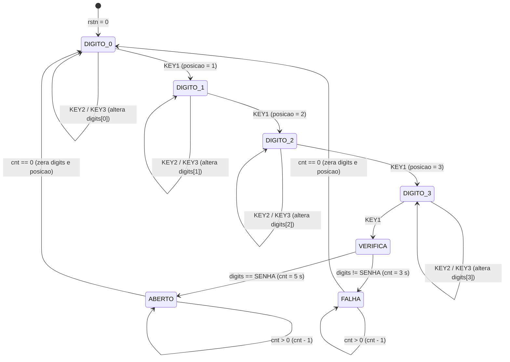

# Projeto-SD

# SafeCrackPro - Cofre digital em FSM (DE2-115)

Cofre eletronico com senha de 4 digitos implementado como maquina de estados finita (FSM) em SystemVerilog, para a placa Altera DE2-115 (Cyclone IV E, EP4CE115F29C7, clock de 50 MHz).

## 1. Arquitetura

O projeto fica em um unico arquivo, `safecrackpro.sv`, com 3 modulos:

| Modulo | Funcao |
|---|---|
| `bcd_to_7segment_anodo` | Converte um numero de 4 bits nos 7 segmentos do display (ativo em baixo) |
| `safecrackpro_fsm` | Maquina de estados: edicao dos digitos, verificacao da senha, LEDs |
| `safecrackpro_top` | Liga a FSM aos 5 displays; e a Top-Level Entity do Quartus |

Pinagem: `safecrackpro_pins.qsf`. Testbench: `tb_safecrackpro_top.sv`.

### Controles na placa

| Controle | Sinal | Acao |
|---|---|---|
| KEY0 | `rstn` | Reset assincrono (volta ao 1o digito, zera a senha digitada) |
| KEY1 | `btn[0]` | Confirma o digito atual e avanca; no 4o digito, verifica a senha |
| KEY2 | `btn[1]` | Soma 1 ao digito atual (9 volta para 0) |
| KEY3 | `btn[2]` | Subtrai 1 do digito atual (0 volta para 9) |
| HEX3, HEX2, HEX1, HEX0 | `seg_pos1..4` | 1o, 2o, 3o e 4o digitos |
| HEX4 | `seg_cur_pos` | Posicao em edicao (1 a 4) |
| LEDG[8:0] | `led_green` | Todos acesos por 5 s: senha correta |
| LEDR[17:0] | `led_red` | Todos acesos por 3 s: senha errada |

## 2. Como os requisitos foram implementados

> Os requisitos abaixo foram levantados a partir do projeto. Ajuste a coluna "Requisito" para o texto exato do enunciado.

| Requisito | Implementacao | Onde no codigo |
|---|---|---|
| Senha de 4 digitos definida no projeto | Constante `SENHA = {4'd4,4'd3,4'd2,4'd1}`. Como `digits[0]` e o 1o digito, a senha escrita "ao contrario" equivale a 1-2-3-4 | `safecrackpro_fsm`, `localparam SENHA` |
| Edicao de um digito por vez | 4 estados `DIGITO_0` a `DIGITO_3`; so o digito do estado atual muda | `case (state)` |
| Soma e subtracao circulares | `9 + 1 = 0` e `0 - 1 = 9`, por `if` explicito | cada estado `DIGITO_n` |
| Uma acao por aperto de botao | Deteccao de borda: `aperta = btn_antes & ~btn`. Segurar o botao nao repete | `assign aperta_confirma/soma/subtrai` |
| Verificacao da senha | Estado `VERIFICA` compara `digits == SENHA` em um ciclo | estado `VERIFICA` |
| Senha correta: LEDs verdes por 5 s | `led_time_cnt` carrega `5*50_000_000 - 1` e conta ate 0 em `ABERTO` | estado `ABERTO`, `led_green` |
| Senha errada: LEDs vermelhos por 3 s | Igual, com `3*50_000_000 - 1`, em `FALHA` | estado `FALHA`, `led_red` |
| Retorno automatico ao inicio | Ao fim do tempo: `digits <= 0`, posicao 0, volta a `DIGITO_0` | estados `ABERTO` e `FALHA` |
| Reset | `negedge rstn` assincrono zera tudo e vai para `DIGITO_0` | `always_ff` |
| Mostrar digitos e posicao nos displays | 5 instancias do decodificador; o HEX4 recebe `position + 1` | `safecrackpro_top` |
| Codificacao one-hot dos estados | `typedef enum logic [6:0]` com um bit por estado | `state_t` |

## 3. Diagrama de estados
## Protótipo inicial da maquina de estados.

## Maquina de estados final

### Tabela de transicoes

| Estado | Condicao | Proximo estado | Saidas / acao |
|---|---|---|---|
| `DIGITO_n` (n = 0 a 2) | KEY1 | `DIGITO_n+1` | `current_position_idx = n+1` |
| `DIGITO_n` | KEY2 | `DIGITO_n` | `digits[n] + 1` (9 vira 0) |
| `DIGITO_n` | KEY3 | `DIGITO_n` | `digits[n] - 1` (0 vira 9) |
| `DIGITO_3` | KEY1 | `VERIFICA` | - |
| `VERIFICA` | `digits == SENHA` | `ABERTO` | `led_time_cnt = 249.999.999` |
| `VERIFICA` | senao | `FALHA` | `led_time_cnt = 149.999.999` |
| `ABERTO` | `led_time_cnt > 0` | `ABERTO` | `led_green = 1`, contador - 1 |
| `ABERTO` | `led_time_cnt == 0` | `DIGITO_0` | zera `digits` e posicao |
| `FALHA` | `led_time_cnt > 0` | `FALHA` | `led_red = 1`, contador - 1 |
| `FALHA` | `led_time_cnt == 0` | `DIGITO_0` | zera `digits` e posicao |

Em cada estado de edicao, a prioridade dos botoes e KEY1 > KEY2 > KEY3 (cadeia `if / else if`).

## 4. Diagramas de tempo (waveforms)

## 5.bugs conhecidos

